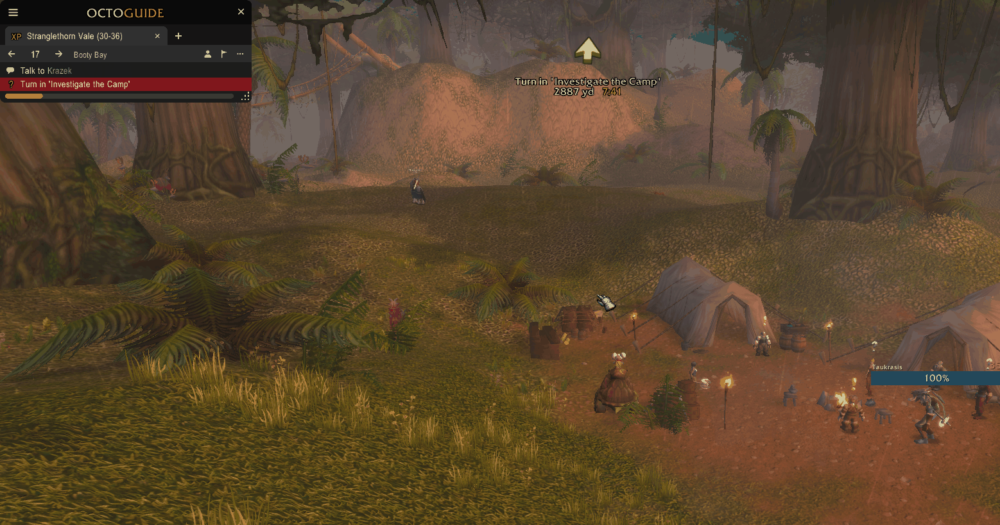
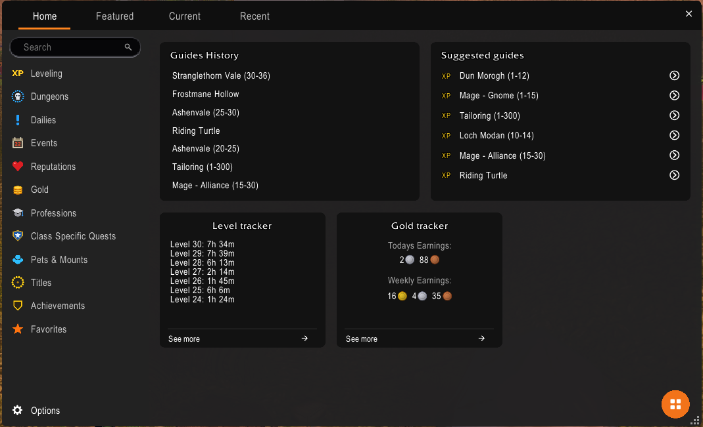
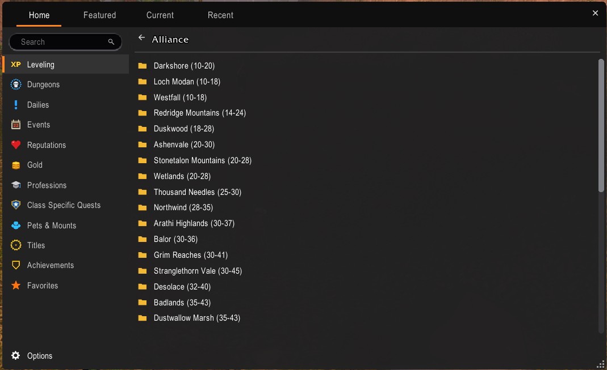
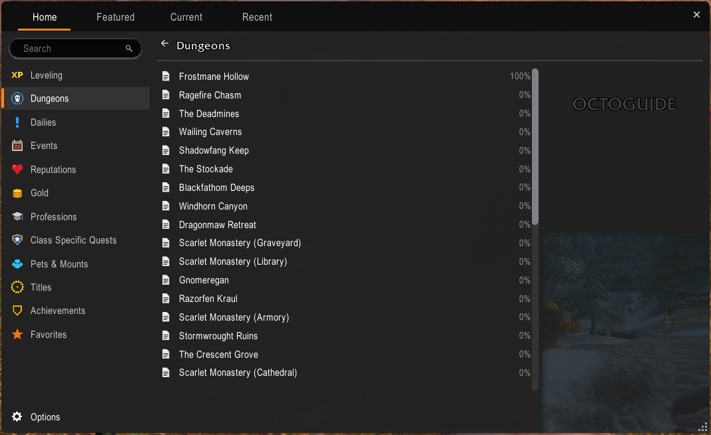
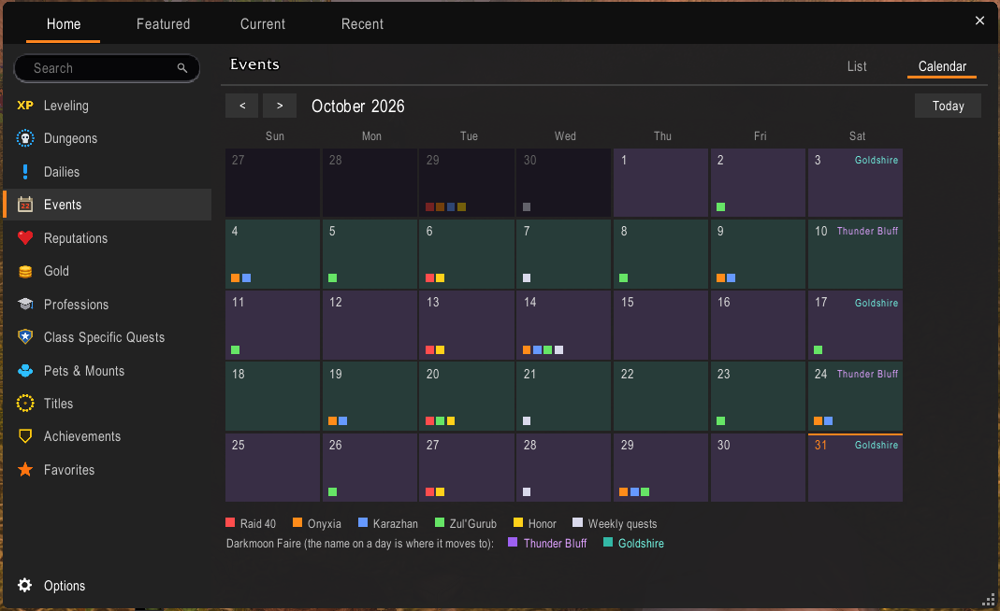
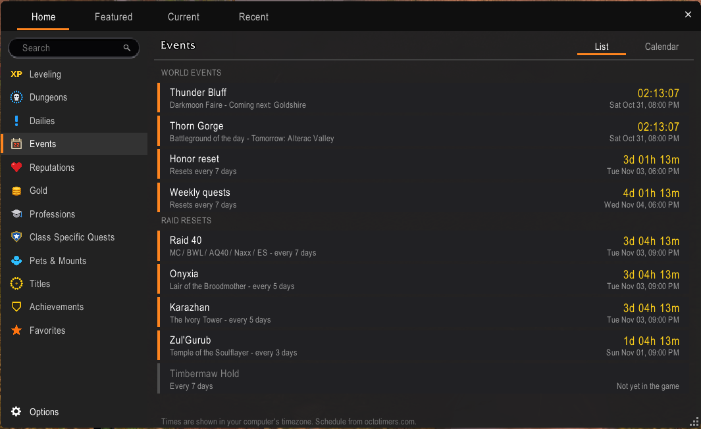
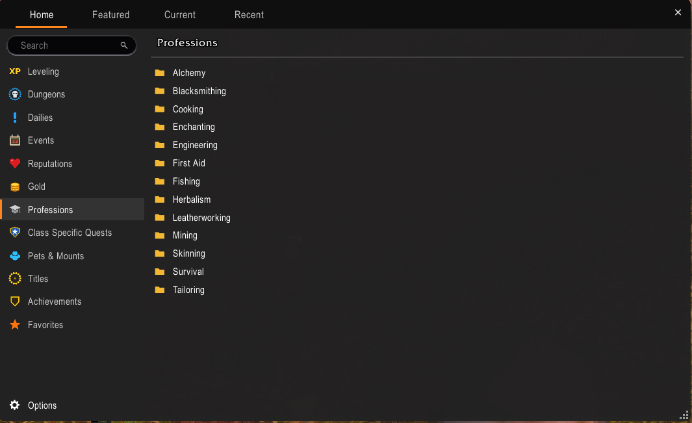
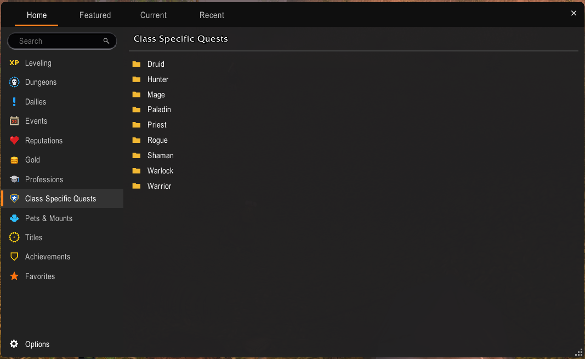

  

<h1 align="center">OctoGuide</h1>

  <b>A speed-leveling guide, waypoint arrow and gold companion for OctoWoW.</b> 
  Follow a step at a time from level 1 to 60, with an arrow that always knows where to go next.

  
  
  
  

  <a href="https://www.youtube.com/c/KyDaOg">YouTube</a> &bull;
  <a href="https://discord.gg/v4xRSyqRJy">KyDa's Discord</a> &bull;
  <a href="https://discord.gg/naMJsBfpYt">OctoWoW Discord</a> &bull;
  <a href="#get-help">Get help</a>

---

> [!TIP]
> **Seeing two arrows?** OctoGuide has its own arrow. To switch off pfQuest's arrow, type **`/pfquest arrow`** in chat. Type it again to bring it back.

> [!NOTE]
> **Beta 0.20.01.** This is the first public release. Everything here works, but some guides have been play-tested more than others. See [Known limitations](#known-limitations) and please [report anything that looks wrong](https://github.com/KyDaog/OctoGuide/issues/new/choose).

## Contents

- [What is OctoGuide?](#what-is-octoguide)
- [Features](#features)
- [Screenshots](#screenshots)
- [Install](#install)
- [Compatibility](#compatibility)
- [Quick start](#quick-start)
- [Commands](#commands)
- [Guide library](#guide-library)
- [Settings](#settings)
- [FAQ](#faq)
- [Known limitations](#known-limitations)
- [Get help](#get-help)
- [Credits](#credits)
- [License](#license)

## What is OctoGuide?

OctoGuide is an addon for the **OctoWoW** private server (WoW 1.12.x). It walks you through the game one step at a time: where to pick a quest up, what to do, where to hand it in, and which quest to take next. A rotating arrow points the way, quests are accepted and turned in for you if you like, and every step ticks itself off as you go.

It also tracks your gold, knows what almost every item sells for, tells you which quest reward is the best pick for your spec, and shows the server's event schedule in a calendar. All of it lives in one dark, rounded window set that stays out of your way.

Every guide is built from the quest database, so quest givers, objectives and chains match what the server actually has, including OctoWoW's own custom quests and zones.

## Features

### Guides
- **174 guides** covering **2,361 quests**: all ten race starter zones, Classic 1-60 for **both Alliance and Horde**, dungeons and raids, the professions, mage class quests and a pets and mounts guide. See the [guide library](#guide-library).
- **Zone folders with level ranges**, such as *Darkshore (10-20)*, so you always know where to be at your level.
- **Chapters that chain together.** When a zone is finished the next one opens by itself, up to the next level range.
- **Smart route.** No guide picked? OctoGuide builds an automatic route for you.
- **Quests you already finished are skipped.** Install it on a level 40 and use `/og catchup` to mark everything before your current step as done.
- **Choices are handled.** Where a quest line makes you pick a side or a branch, the guide asks you and follows your pick.
- **Race and class aware.** Quests your character cannot take are removed from every guide at login.
- **OctoWoW custom content.** Custom zones such as Gilneas, Northwind, Balor, Grim Reaches, Moonwhisper Coast, Lapidis Isle and Tel'Abim are included.

### The viewer
- Numbered steps with clear goal rows: **Talk to**, **Accept**, **Turn in**, **Complete**.
- A progress bar, the current area name, and notes for the tricky steps.
- Tabs for several guides at once, back and skip buttons, and a mouse wheel to scroll long steps.
- Drag to move it, use the corner grip to resize it, lock it in place, or make it transparent.

### Arrow
- A live 3D-style arrow with the **distance and travel time** to the next goal. Travel time is measured from how fast you actually move.
- Points across zones too, and tells you when you need to go to another zone.
- `/og arrow flip` fixes a reversed arrow in one command.

### Automation
- **Auto-accept** and **auto turn-in** for the quests in your current step. Hold **SHIFT** to pause.
- Optional **accept everything** mode for quests outside the guide.
- Optional **auto-sell of gray items** at vendors.

### Gold and items
- **Gold tracker** with Today, Yesterday, Last 7 days, Last 30 days and All time, a gained-versus-spent pie chart and a detailed income report.
- **Level tracker** showing how long you spent at each level.
- **Vendor prices for 19,663 items** built in, plus prices OctoGuide learns when you sell and when you browse the Auction House.
- **Sell advice in tooltips**: vendor or Auction House.
- **Quest reward picker** marks the best reward for your spec. Your spec is read from your talents, or set it yourself with `/og spec`.
- **Gear Finder** for dungeon and raid loot, with upgrade markers.

### Events
- **Events page** with a list view and a calendar view, switched with one toggle.
- Darkmoon Faire location, the battleground of the day, raid resets, weekly and honor resets, shown in your local time.

### Fits your UI
- A dark, rounded look with an orange accent, built to sit well with PandaUI and pfUI.
- One failing module never stops the others from loading.

## Screenshots

| | |
|---|---|
|  **Guide viewer and waypoint arrow** |  **Home: history, suggestions, level and gold trackers** |
|  **Zone folders with level ranges** |  **Dungeon guides with progress** |
|  **Events calendar** |  **Events list with live countdowns** |
|  **Profession guides** |  **Class quest folders** |

## Install

**You need:** the OctoWoW client (WoW 1.12.x). OctoGuide reads quest data from **pfQuest** with the **pfQuest-octo-plus** data pack, so install those first.

1. Install **pfQuest** and the **pfQuest-octo-plus** data pack. The data pack folder must be named `pfQuest-octo-plus`.
   Do not use the launcher's *pfQuest [TurtleWoW DB]* button, and keep `pfQuest-octo` and `pfQuest-turtle` disabled.
2. Download **`OctoGuide-0.20.01.zip`** from the [latest release](https://github.com/KyDaog/OctoGuide/releases/latest).
3. Unzip it and copy the **`OctoGuide`** folder into your game folder: `Interface\AddOns\`.
   You should end up with `Interface\AddOns\OctoGuide\OctoGuide.toc`.
4. **Fully restart the game client.** `/reload` is not enough the first time, because OctoGuide has new files.
5. Log in and check the character select screen: **OctoGuide** should be listed under *AddOns*.

> [!IMPORTANT]
> When you update OctoGuide, close the game, **delete the old `OctoGuide` folder** and copy the new one in. Your settings and progress are kept, because they live in your `WTF` folder, not in the addon.

## Compatibility

OctoGuide is built to look and behave well next to the UI addons OctoWoW players actually use.

| Addon | Status | Notes |
|---|:---:|---|
| **pfQuest** + **pfQuest-octo-plus** | Required data | OctoGuide reads its quest, NPC and object database. Use `/pfquest arrow` to turn off pfQuest's own arrow |
| **pfUI** | Supported | Windows and the Gear Finder tab match pfUI's skin |
| **PandaUI** | Supported, all three themes: **Modern WoW**, **Modern** and **Classic WoW** | Windows, tabs and the arrow follow whichever PandaUI theme you pick, including Modern WoW's chunky tabs. OctoGuide reuses PandaUI's player arrow model so the arrow turns correctly |
| No UI addon | Supported | The default dark OctoGuide look is used |

> [!NOTE]
> OctoGuide is made for the 1.12 client (Interface 11200) and was built and tested on OctoWoW.

## Quick start

1. Type **`/og`** to open the guide viewer. On first login OctoGuide picks the guide that matches your race and class, or the smart route if there is none.
2. Follow the **arrow**. The top row is your current step, the rows below show what comes next.
3. Open the guide menu with **`/og guides`** to pick a zone and level range.
4. Type **`/pfquest arrow`** once to switch off pfQuest's own arrow so you only see OctoGuide's.
5. Type **`/oghelp`** any time to see every command.

## Commands

Type **`/oghelp`** in game to open the same list in a window. Square brackets mean "optional".

### Guide viewer
| Command | What it does |
|---|---|
| `/og` | Show or hide the guide viewer |
| `/og show` / `/og hide` | Show or hide it, never toggle |
| `/og guides` (or `/og menu`) | Open the guide menu |
| `/og find` | Search for a guide by name |
| `/og guide <name>` | Load a guide, for example `/og guide Darkshore`. `/og guide smart` loads the smart route |
| `/og next` | Go to the next chapter of the current guide |

### Moving through a guide
| Command | What it does |
|---|---|
| `/og skip` | Skip the current step |
| `/og back` | Go back one step |
| `/og catchup` | Mark every step before the one you are on as done |
| `/og clear` | Put the arrow back on the guide after pointing it somewhere else |
| `/og sync` | Read your finished quests from the server |

### Arrow
| Command | What it does |
|---|---|
| `/og arrow [on\|off]` | Turn the waypoint arrow on or off |
| `/og arrow flip` | Flip the arrow direction if it points the wrong way |
| `/og arrow hz <20-144>` | How often the arrow turns update, per second |
| `/pfquest arrow` | Turns off **pfQuest's** own arrow (this is a pfQuest command) |

### Quest automation
| Command | What it does |
|---|---|
| `/og autoaccept [on\|off]` | Accept the quests the guide wants automatically |
| `/og autoturnin [on\|off]` | Turn in guide quests automatically |
| `/og acceptall [on\|off]` | Also accept quests that are not part of the guide |
| `/og spec [name\|auto]` | Spec used to mark the best quest reward, for example `Fury` or `Holy`. `auto` reads your talents |
| `/og rewards` | Re-mark the reward choice while a quest reward screen is open |

### Gold and gear
| Command | What it does |
|---|---|
| `/og gold` | Open the Gold tracker |
| `/og report` | Open the detailed gold report |
| `/og autosell [on\|off]` | Sell gray items when you open a vendor |
| `/og prices` | Show how many item prices OctoGuide knows |
| `/og pricepanel [tooltip\|fixed]` | Show prices under the tooltip, or in a fixed spot you can move |
| `/og gear` | Open the Gear Finder |

### Windows and help
| Command | What it does |
|---|---|
| `/og settings` | Open the settings window |
| `/og lock [on\|off]` | Lock window positions and sizes |
| `/og reset` | Reset window positions and sizes (then `/reload`) |
| `/og here` | Print your map position, zone and target, useful in bug reports |
| `/og npctimers` | Pause or resume the guide timers while you talk to an NPC |
| `/oghelp` (or `/og help`) | Open the in-game command list |

> [!TIP]
> `/og` and `/octoguide` are the same command.

## Guide library

| Section | Guides | Levels | What is in it |
|---|---:|---:|---|
| **Race starter zones** | 13 | 1-12 | One folder per race: Human, Dwarf, Gnome, Night Elf, High Elf, Orc, Troll, Undead, Tauren, Goblin |
| **Classic 1-60: Alliance** | 46 | 10-60 | Zone chapters, including the OctoWoW custom zones |
| **Classic 1-60: Horde** | 39 | 10-60 | Zone chapters, including the OctoWoW custom zones |
| **Dungeons** | 35 | 13-60 | Quests and loot for the dungeons |
| **Raids** | 11 | 60-60 | Quests and loot for the raids |
| **Professions** | 13 | 1-60 | Leveling guides for every profession |
| **Class quests** | 16 | 1-60 | Mage quest lines |
| **Pets and mounts** | 1 | 18-60 | Pet and mount guide |

The complete list of every zone, dungeon, raid and profession guide is in **[docs/GUIDES.md](docs/GUIDES.md)**.

## Settings

Open **`/og settings`** (or the hamburger menu in the viewer):

| Setting | Meaning |
|---|---|
| Auto-accept guide quests | Accept quests from the current step automatically |
| Auto turn in guide quests | Hand in finished quests automatically |
| Auto-start next guide chapter | Move on when a chapter is finished |
| Show waypoint arrow | The arrow on or off |
| Lock window positions / sizes | Stop windows being dragged by accident |
| Transparent viewer | See-through viewer background |
| Auto-sell gray items at vendors | Sell junk when you open a vendor |

Settings are saved per account and your guide progress is saved per character, in `WTF\Account\<name>\SavedVariables\OctoGuide.lua` and the matching character file.

## FAQ

<b>I see two arrows. How do I get rid of one?</b>

Type `/pfquest arrow` to turn off pfQuest's arrow. OctoGuide's own arrow stays on. Type the same command again if you ever want pfQuest's back.

<b>The arrow points the wrong way.</b>

Type `/og arrow flip`. If it is still off, stand still for a moment: the arrow calibrates itself from how you move.

<b>The NPC is not where the marker says.</b>

Some NPCs patrol or are only there during an event. The guide marks the usual spot, and the step note says when an NPC moves around. If you find one in a different place, stand there, type `/og here` and [open an issue](https://github.com/KyDaog/OctoGuide/issues/new/choose) with the line it prints.

<b>A quest I need is missing, or I get quests twice.</b>

Each quest lives in the guide for the zone where it is accepted. Quests that are open to several races can show up in two places, but a step you already finished is marked done. If something is genuinely missing, [open an issue](https://github.com/KyDaog/OctoGuide/issues/new/choose) with the quest name.

<b>I started OctoGuide at level 35. How do I skip what I already did?</b>

Finished quests are detected automatically. For anything the game does not remember, move to the step you are really on and type `/og catchup`.

<b>The step shows no arrow.</b>

A small number of objectives have no position in the database, for example crafted items. Those steps carry a note that tells you what to do instead.

<b>Do the level numbers have to match exactly?</b>

No. Level numbers in the guides are estimates for a steady pace. If you are a few levels behind or ahead, keep going.

<b>How do I reset everything?</b>

`/og reset` puts the windows back to their default positions. To wipe all progress, close the game and delete `OctoGuide.lua` from your `SavedVariables` folder.

<b>Does it work with pfUI or PandaUI?</b>

Yes. OctoGuide's windows are built to match both, and it adds its own tab to the character window.

## Known limitations

- This is a **beta**. Guides were generated from the quest database and then fixed by hand wherever play-testing found a problem. The Alliance side has been played far more than the Horde side, so **Horde 30-60 especially needs feedback.**
- **Level markers are estimates**, not hard gates.
- **Group and elite quests are left out** of the speed-leveling guides on purpose.
- **Some steps have no arrow** because the database has no position for the objective. They have a note instead.
- **Patrolling NPCs** are marked at their usual spot.
- A few quests that you must hand in far from their zone are left out to keep the route short.
- **Placeholder folders.** The guide menu already shows folders for Dailies, Reputations, Titles and Achievements, and for the Druid, Hunter, Paladin, Priest, Rogue, Shaman, Warlock and Warrior class quests. Those are empty for now. Mage class quests are the first ones written.

## Get help

- **Bug or wrong step?** [Open an issue](https://github.com/KyDaog/OctoGuide/issues/new/choose). Include your faction and level, the guide name and step number, and what you expected.
- **Questions or chat:** [KyDa's Discord](https://discord.gg/v4xRSyqRJy) or the [OctoWoW Discord](https://discord.gg/naMJsBfpYt).
- **Videos and updates:** [YouTube](https://www.youtube.com/c/KyDaOg).
- **In game:** `/oghelp` lists every command.
- **Red error text?** Copy it word for word into an issue. It makes the bug much easier to find.

More detail is in **[SUPPORT.md](SUPPORT.md)**.

## Credits

OctoGuide is made by **KyDa** ([YouTube](https://www.youtube.com/c/KyDaOg)). Thank you to everyone whose work made it possible:

| Who | What |
|---|---|
| **pfQuest** and **pfQuest-octo / pfQuest-octo-plus** | The quest, NPC and object database behind every guide |
| **Thomas (PandaUI)** | The item vendor price table is ported from PandaUI, and a Turtle WoW database index used to double-check quest data |
| **octotimers.com** | The event and reset schedule: Darkmoon Faire, battleground of the day, raid resets |
| **AtlasLoot (Turtle WoW)** | Dungeon and raid loot tables |
| **OctoPawn / OctoSpec (iGreed1993)** | Spec weights for the upgrade markers |
| **The OctoWoW community** | Testing, bug reports and feedback |

Full notes are in **[CREDITS.md](CREDITS.md)**.

## License

Copyright &copy; 2026 KyDa. **All rights reserved.** You are welcome to download and use OctoGuide for your own play. You may not copy, modify, re-upload or redistribute it without written permission. Third-party data keeps its own terms, see [CREDITS.md](CREDITS.md). Read the full text in **[LICENSE](LICENSE)**.

*OctoGuide is a community project. It is not made by, or endorsed by, Blizzard Entertainment or the OctoWoW team. World of Warcraft is a trademark of Blizzard Entertainment.*
